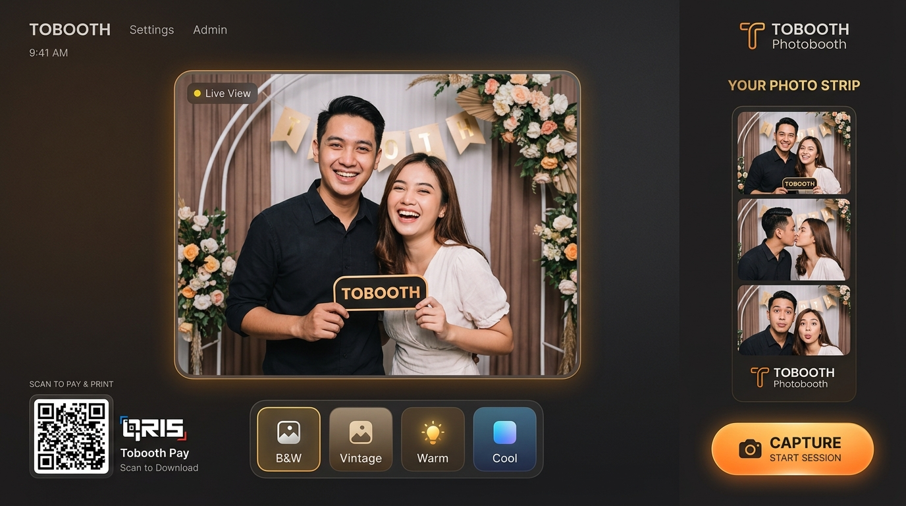

# Tobooth — Web-based Interactive Photobooth PWA & Admin Dashboard

An interactive, high-performance offline-first photobooth ecosystem designed for modern event experiences.

---

## 📸 Application Preview



---

## 🚀 Project Overview
**Tobooth** is a full-stack, enterprise-grade software ecosystem built to power digital photobooth kiosks. The project consists of three main components:
1. **Tobooth App (Client PWA):** An interactive, touch-screen Progressive Web App optimized for iPad/tablet installations at events, enabling guests to purchase sessions, apply filters, pose for photo bursts, generate GIFs, and download/print results.
2. **Tobooth Dashboard (Admin Panel):** A secure, data-rich management console for kiosk operators to track sales metrics, configure price list packages, manage promotional vouchers, and upload custom photo strip templates.
3. **Tobooth Backend (API Server):** A robust Node.js REST API coordinating payments, cloud storage uploads, transactional emails, database operations, and background jobs.

---

## 🛠️ Technology Stack

| Component | Technologies Used | Key Purpose |
| :--- | :--- | :--- |
| **Kiosk App (PWA)** | React 19, TypeScript, Tailwind CSS v4, Vite, Konva.js, Zustand | Touch-screen UI, real-time camera feeds, and graphic canvas rendering. |
| **Admin Dashboard** | React 19, TypeScript, Recharts, Tailwind CSS v4, React Router 7 | Business intelligence charts, settings management, and CRUD portals. |
| **Backend API** | Node.js, Express, TypeScript, Mongoose, Resend, BullMQ, AWS S3 SDK | REST endpoints, payment integrations, email notifications, and queueing. |
| **Database & Cache** | MongoDB, Redis | Persistent document storage and task queues for background jobs. |

---

## ⚡ Quick Start (Local Run)

To run the entire ecosystem locally:

### 1. Prerequisite
* Node.js installed (v18+)
* Redis running locally (default port `6379`)

### 2. Run Backend API Server
```bash
cd backend
npm install
npm run dev
```
*Server will start on [http://localhost:3000](http://localhost:3000)*

### 3. Run Admin Dashboard
```bash
cd dashboard
npm install
npm run dev
```
*Dashboard will start on [http://localhost:5173](http://localhost:5173)*

### 4. Run Photobooth App (Client)
```bash
cd photobooth-app
npm install
npm run dev
```
*Client App will start on [https://localhost:5174](https://localhost:5174) (requires HTTPS)*

---

## ☁️ Deployment Guide

### Frontend (App & Dashboard)
Deploy both folders (`photobooth-app` and `dashboard`) as separate projects to **Vercel** or **Netlify**. Set the `VITE_API_URL` environment variable pointing to your deployed backend API URL.

### Backend API
Deploy the `backend` folder to a Node.js hosting provider such as **Render** or **Railway**. Set the required environment variables:
* `MONGODB_URI` (MongoDB Atlas hosted instance)
* `REDIS_HOST` & `REDIS_PORT` (e.g. Upstash Redis host)
* `R2_ACCOUNT_ID`, `R2_ACCESS_KEY_ID`, `R2_SECRET_ACCESS_KEY`, `R2_PUBLIC_URL`, `R2_BUCKET_NAME` (Cloudflare R2 storage credentials)
* `MIDTRANS_SERVER_KEY` & `MIDTRANS_CLIENT_KEY` (Midtrans credentials)
